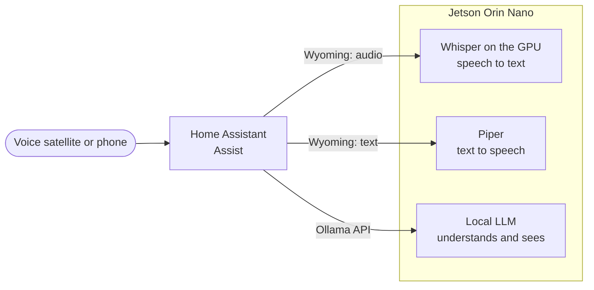

# NanoBrain

NanoBrain turns an NVIDIA Jetson Orin Nano into the local brain of a
[Home Assistant](https://www.home-assistant.io/) home: it hears, speaks, understands orders and
sees, and nothing leaves the house. It publishes ready-to-run container images for the Jetson and
articles that explain every decision with measurements.

Home Assistant still runs the house. NanoBrain is the set of pieces it talks to.

## How the pieces fit

Each piece speaks a standard protocol, so any of them can be swapped without touching the others:

- **[Wyoming](https://github.com/OHF-Voice/wyoming)** is Home Assistant's small protocol for voice
  services: audio in, text out (speech to text), or the other way round (text to speech). Home
  Assistant finds a Wyoming server by its host and port.
- **The [Ollama](https://ollama.com/) API** serves the language model. Home Assistant's Assist
  tries simple orders ("turn on the kitchen light") itself first, and only hands the rest to the
  LLM, which acts through Home Assistant's own API.

| Capability | Piece | Where it comes from |
| --- | --- | --- |
| Hear (speech to text) | Whisper on the GPU, Wyoming server | [`wyoming-whisper-gpu`](images/wyoming-whisper-gpu/), built here |
| Speak (text to speech) | Piper, Wyoming server | The official `rhasspy/wyoming-piper` image, on the CPU |
| Understand and order | A local LLM in Ollama, as Assist's conversation agent | The official Ollama image; the model is still to be chosen and measured |
| See | The same LLM, if it is multimodal, through Home Assistant's AI tasks | Still to be measured |

An image is built here only when no maintained one serves the Jetson. Ollama and Piper already
publish theirs, so NanoBrain documents how to use them instead of rebuilding them.

## Hardware

A **Jetson Orin Nano Super**, with 8 GB shared by the CPU and the GPU, on **JetPack 6.2** (L4T
R36.4, CUDA 12.6). The images are arm64 only. Another JetPack is a change of build arguments, not a
fork: see each image's README.

The shared memory is the constraint that shapes everything else. The GPU has no memory of its own,
so every model loaded on it comes out of the same 8 GB the LLM needs.

## Images

| Image | What it is |
| --- | --- |
| [`wyoming-whisper-gpu`](images/wyoming-whisper-gpu/) | Wyoming's faster-whisper with CTranslate2 compiled for the Jetson's GPU |

They are public at `ghcr.io/xoadev/nanobrain/<image>`: no account or token is needed to pull them.
Each image has its own version and its own [releases](https://github.com/xoadev/nanobrain/releases),
tagged `<image>-vX.Y.Z` with what changed and the digest. Pin the image by that digest in your
compose file: a published tag is never rewritten, and the digest makes sure of it.

## Articles

[`docs/`](docs/README.md) has one article per decision, with the numbers measured on the Jetson and
how to repeat them.

## Working on it

Everything runs through `make` (`make help` lists the targets). `make lint` runs on any machine;
`make test` builds the images and runs each one's check inside it, which needs an arm64 machine
with Docker. Compiling CUDA needs `nvcc`, not a GPU, so pull requests build on GitHub's arm64
runners. [`AGENTS.md`](AGENTS.md) has the conventions.

## License

[Apache-2.0](LICENSE). The models the images download carry their own licenses and are not
redistributed here: they are fetched to your volume on first start.
